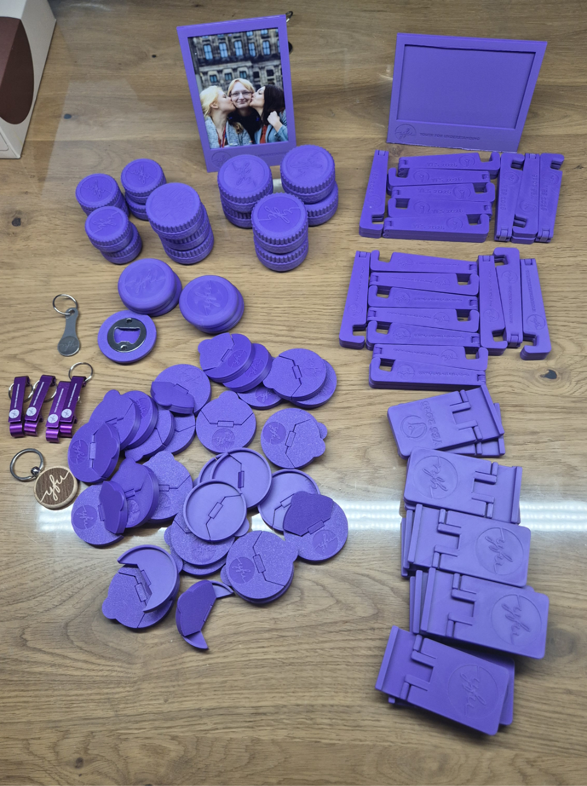

# YFU-Merchandising

## Disclaimer
Dieses Repository ist ein privates Fanprojekt und steht in keiner offiziellen Verbindung zu Youth For Understanding (YFU). Ich bin weder Mitarbeiter noch offizieller Vertreter von YFU und handle nicht im Namen der Organisation.

Die bereitgestellten DIY-Dateien dienen ausschließlich der privaten Erstellung von Fan- und Merchandising-Artikeln. Alle Marken, Logos und Namensrechte verbleiben bei ihren jeweiligen Eigentümern.

Links zu Produkten, Materialien oder Druckdienstleistern sind unverbindliche Empfehlungen. Es handelt sich nicht um Affiliate-Links – ich erhalte keinerlei Provision oder Vergütung.

## Das Repository
In diesem Repository möchte ich alle meine YFU-Merchandising Aktivitäten sammeln die ich im Laufe der Jahre gemacht habe. Angefangen hat es während Corona mit ein paar 3D gedruckten Teilen. Das hat sich dann entwickelt und nach und nach sin andere dinge hinzugekommen. So sind irgendwann Aufkleber hinzugekommen. Inzwischen habe ich auch einen Laser-Gravierer so das auch hier Objekte entstanden sind.
Hier möchte ich die Projekte vorstellen und andere inspirieren YFU  Merchandisingobjekte bereitzustellen. Schaut doch mal ob ihr für das nachte Treffen etwas findet was ihr selber herstellen könnt. 

Ich habe die Objekte der jeweiligen Technik zu geordnet. Ich habe immer alle nötihen dateien verknüpft, so könnt ihr sie selber nachbauen.

## 3D-Druck
[hier](3d-print) findet ihr verschiden 3d-Druck Projekte. 

## Laser Gravur
[hier](gravur) findet ihr verschiden Laser Gravur Projekte. 
